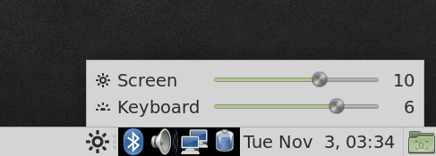

# pyra-backlight

Screen and keyboard brightness control for the DragonBox Pyra under MATE: a
panel applet with a slider for each, and a small service that dims the screen
when you walk away.

## The problem

On the stock Pyra image there is no working brightness control in MATE. The
Pyra has two devices in `/sys/class/backlight`: `backlight`, the screen, and
`keyboard-backlight`. MATE's backlight helper recognises neither name and
falls back to the first entry it finds, which is the keyboard. So MATE's
brightness applet and its idle dimming both change the keyboard light, and
the screen never changes. The image works around this by turning MATE's
backlight control off (`backlight-enable=false` in `pyra-config-desktop`),
which leaves you with no brightness control at all.

This package names each device explicitly and sets it through logind's
`SetBrightness`, which lets the logged-in user change their own seat's
backlights without root. No udev rules, no sudo, no setuid helpers.

## Requirements

- A DragonBox Pyra running the Debian-based image with the MATE desktop
- The package is built against Debian trixie

Dependencies (`python3-gi`, the GTK and MATE panel introspection bindings,
systemd) are pulled in by apt.

## Installing

Download `pyra-backlight_<version>_all.deb` from the Releases page. It is
architecture-independent, so there is only one file per release.

Install it with apt rather than `dpkg -i`, so the dependencies come along:

    sudo apt install ./pyra-backlight_<version>_all.deb

The `./` matters; without it apt looks for a package by that name in the
archive and fails.

Then:

1. Right-click the panel, *Add to Panel…*, and pick *Pyra Brightness*.
2. Log out and back in to start the idle dimmer. It is enabled for every user
   on install, but only starts with a new session.

To upgrade, install the newer `.deb` the same way. To remove it:

    sudo apt remove pyra-backlight

## Using the applet

Click the panel icon to open the sliders.

| Input | Does |
| --- | --- |
| Click the icon | Open the sliders. Click again, Escape, or click elsewhere to close. |
| Left / Right | Move the selected slider one step |
| Up / Down | Switch between the screen and keyboard sliders |
| Home / End | Jump to either end |
| Scroll on the icon | Screen brightness |
| Shift + scroll on the icon | Keyboard brightness |

The screen slider stops at 1, not 0, so you cannot black out the screen from
it and then have to find the slider again in the dark. The applet does no work
while the popup is closed.

## Idle dimming

`pyra-idle-dim` runs as a systemd user service. When the session goes idle it
drops the screen to 20% of maximum (or the depth set below), and when you come
back it restores the previous level. If you changed the brightness while it was dimmed, your newer
value is kept and nothing is restored.

The keyboard light goes off when the session goes idle and comes back on with
the session, again only if you did not change it meanwhile. At login it is set
to its level from `~/.config/pyra-backlight.conf`, after MATE's power manager
has set it to 100% (which it does on AC). The file also sets how far the
screen dims:

    [keyboard]
    level = last

    [screen]
    dim = 20

`last` (the default) is the level the light had at your last idle or logout,
or 5% the first time. A number from 0 to 100 sets that level at every login.

`dim` is the percentage of maximum the screen drops to, from 1 to 100, or
`off` for no screen dimming (the keyboard light is still handled). It never
goes below the lowest step that still lights the panel. Without the key, the
`PYRA_DIM_PERCENT` environment variable is used if set (how 0.3 and earlier
were configured), then 20.

After editing the file run `systemctl --user reload pyra-idle-dim`; a
keyboard level changed to a number is set at once. The
keyboard part needs the light to be an LED (`*::kbd_backlight`); on a kernel
without one, only the screen is handled.

At the login screen (lightdm) the keyboard light is set to 20% (the
`kbd-brightness-on-ac` value in the schema override), before
each greeter at boot and after every logout, so the password is not typed in
the dark. No user is known there, so this level is not in the per-user file.
To turn it off, put this in a file under `/etc/lightdm/lightdm.conf.d/`:

    [Seat:*]
    greeter-setup-script=

At login on AC, MATE's power manager sets the keyboard light to its
`kbd-brightness-on-ac` setting before pyra-idle-dim sets your level. Its
default is 100, which made the light jump to full for about a second. The
package sets the default to 20, the login screen's level, so the light goes
straight from the login screen to your level.

The idle delay is MATE's session setting, not something in this package. Set
it in *Control Center → Screensaver*, or:

    gsettings set org.mate.session idle-delay 5

(in minutes). The same delay starts the screensaver and MATE's idle sleep timer.

`PYRA_DIM_DEVICE` (set with `systemctl --user edit pyra-idle-dim.service`)
selects a different device under `/sys/class/backlight` if
you need it. The default is `backlight`. See `man pyra-idle-dim` for the
details.

To turn off both the screen and the keyboard handling for your user:

    systemctl --user mask --now pyra-idle-dim.service

`disable` does not work here, because the package enables the unit globally
and a per-user `disable` cannot remove that.

## How it works

Both tools call `SetBrightness` on the current logind session over D-Bus.
logind allows the session owner to change backlights and LEDs on their own
seat, which is why nothing needs root.

The usual convention is for a keyboard light to be an LED named
`*::kbd_backlight`, and a kernel that declares the Pyra's that way leaves only
the screen in `/sys/class/backlight`. The applet looks for such an LED first
and falls back to `keyboard-backlight`. The LED has a linear 0–100 scale, so
the slider steps through the stock kernel's nine levels
(0 1 2 5 10 20 40 60 100 %) and behaves the same on either kernel.

The idle signal comes from the MATE session manager's presence status, so
anything that counts as activity to the screensaver also wakes the screen.

## Notes and gotchas

- Leave MATE's own backlight control off (`backlight-enable=false`, the image
  default). If it is on, MATE's power manager goes back to dimming the
  keyboard on idle, alongside this package dimming the screen.
- Leave MATE's "Reduce keyboard backlight brightness" (battery) and "Dim
  display when idle" (AC) unticked. Either one hands the keyboard light back
  to MATE, which then fights `pyra-idle-dim` over it.
- The keyboard slider only appears if a keyboard light is found, either the
  `*::kbd_backlight` LED or the `keyboard-backlight` device.

## Troubleshooting

**The screen does not dim when idle.** Check that the service is running:

    systemctl --user status pyra-idle-dim.service
    journalctl --user -u pyra-idle-dim.service

If it shows as inactive right after installing, you have not logged out and
back in yet. The session restarts it at each login, from
`/etc/xdg/autostart/pyra-idle-dim.desktop`.

**A slider moves but the light does not change.** The applet prints
`SetBrightness failed` with logind's error when a call is refused. Look for it
with `journalctl --user | grep SetBrightness`, or in `~/.xsession-errors`,
depending on how your session captures D-Bus-activated programs. The usual
cause is running outside a proper logind session, such as from an SSH login
or a session started without `pam_systemd`.

## Building from source

    ./build-deb.sh

builds `dist/pyra-backlight_<version>_all.deb` in a Debian trixie container,
so it needs Docker. On a Debian machine, `dpkg-buildpackage -b -uc -us` also
works.

## License

GPL-2.0-or-later. See `COPYING`.
